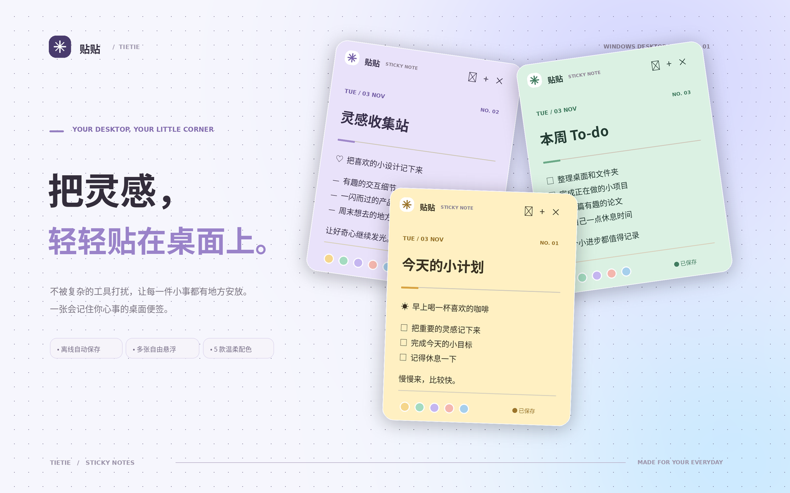

<div align="center">

# ✳ 贴贴 · Tietie Sticky Notes

**给 Windows 桌面留一点柔软的位置。** 纯本地、自动保存、多张独立悬浮便签。



</div>

## 功能

- 🗒️ **独立便签窗口**：想开多少张就开多少张，自由拖动、缩放。
- 🎨 **五种低饱和配色**：奶油黄、薄荷绿、香芋紫、蜜桃粉、晴空蓝。
- 📌 **一键置顶**：方便在工作时随手记事，也可以取消置顶。
- 💾 **离线自动保存**：输入即暂存，约 0.3 秒后写入本地 JSON；无需登录、无需联网。
- 🧭 **系统托盘**：隐藏后仍可从任务栏通知区域找回，托盘支持新建、显示全部、隐藏全部。
- 📄 **导出 TXT**：右下角「···」菜单导出单张便签。
- ⌨️ **快捷键**：聚焦便签时 `Ctrl + N` 新建，`Ctrl + W` 隐藏。
- 🛡️ **基础安全**：Electron `contextIsolation` + `sandbox`，渲染进程无 Node.js 访问权。

## 下载 Windows 安装包

发布到 GitHub 后，进入仓库的 **Actions → Build Windows app → Run workflow**，构建成功后在运行页面的 **Artifacts** 下载 `tietie-windows-x64`。它包含：

- `Tietie-1.0.0-x64-nsis.exe`（Windows 安装版）
- `Tietie-1.0.0-x64-portable.exe`（Windows 便携版）

如果推送 `v1.0.0` 这样的 Git tag，工作流会同时在 **Releases** 页面发布 EXE 下载。

> 目前源码已准备好，但没有在此环境实际执行 Windows 打包。第一次运行非代码签名的 EXE 时，Windows SmartScreen 可能显示警告。

## 本地开发

需要 Node.js 22+（推荐）、Windows 10/11。

```bash
npm install
npm start
```

运行测试：

```bash
npm run check
```

Windows 本地打包：

```bash
npm run dist:win
```

> `npm start` 不会从本仓库下载更新；安装依赖需要访问 npm registry。

## 放到 GitHub

1. 使用现有空仓库 [`kaeai226-gif/kaiea`](https://github.com/kaeai226-gif/kaiea)。
2. 在本项目的根目录打开 PowerShell 或 Git Bash：

```bash
git init
git add .
git commit -m "feat: initial Windows sticky note widget"
git branch -M main
git remote add origin https://github.com/kaeai226-gif/kaiea.git
git push -u origin main
```

3. 在 **Actions** 页面运行 `Build Windows app`；或执行以下命令自动发布一个 Release：

```bash
git tag v1.0.0
git push origin v1.0.0
```

## 数据存放位置

应用保存于 Electron 的用户数据目录（通常在 Windows 的 `%APPDATA%/tietie-sticky-notes/notes.json`；实际路径取决于 Electron 的应用名称）。卸载前请自行备份重要便签。

每张便签记录标题、正文、配色、置顶状态和窗口位置。软件不会主动上传或分析用户内容。

## 项目结构

```text
src/
  main.js        Electron 窗口、托盘、原生菜单、持久化
  preload.js     安全的窗口接口
  renderer.js    编辑、换色与 UI 交互
  store.js       本地存储与校验
  index.html     便签页面
  styles.css     五套主题样式
assets/          Windows 图标
.github/workflows/windows-release.yml  GitHub Actions Windows 构建
opens-in-browser: src/index.html       无需 Electron 的静态预览模式
```

## 技术栈与授权

Electron + HTML + CSS + JavaScript，不依赖云服务、数据库或 UI 框架。MIT License。

欢迎提交 Issues / PR 一起完善（例如：待办勾选、Markdown、开机自启、透明度设置）。
